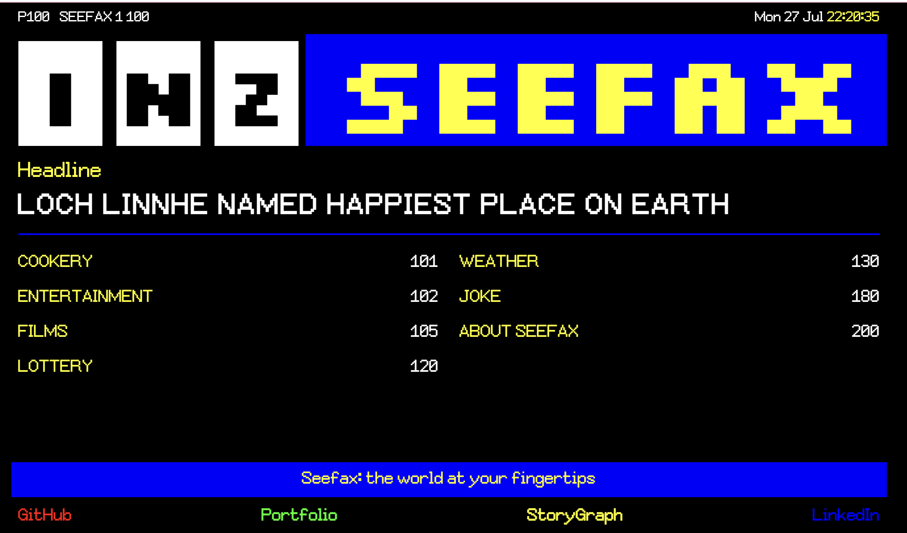

# Seefax

A recreation of the BBC's **Ceefax** teletext service ("Page 100"), rebuilt as a modern single-page web app — React + Vite + TypeScript + Tailwind CSS + React Router.

Type a 3-digit page number on your keyboard (or click a row) to jump straight to that page, just like a real teletext remote.



## Features

- **Type-to-navigate**: typing digits builds up a 3-digit page number that replaces the number in the top-left corner in real time. If it matches a listed page, it navigates there automatically.
- **Click-to-navigate**: every row on the index page is also a clickable link.
- **Responsive**: on mobile the index collapses to a single column and only the "SEEFAX" wordmark is shown (the INZ letter boxes are hidden to save space).

## Pages

| Page          | Number | Route                       | Source                                                                                                |
| ------------- | ------ | --------------------------- | ----------------------------------------------------------------------------------------------------- |
| Home / Index  | 100    | `/100` (`/` redirects here) | live random headline + page index                                                                     |
| Cookery       | 101    | `/101`                      | random recipe — [TheMealDB](https://www.themealdb.com/)                                               |
| Entertainment | 102    | `/102`                      | "Never Gonna Give You Up" embed                                                                       |
| Films         | 105    | `/105`                      | upcoming releases — [TMDB](https://www.themoviedb.org/)                                               |
| Lottery       | 120    | `/120`                      | EuroMillions jackpot (unofficial API, joke fallback if it fails)                                      |
| Weather       | 130    | `/130`                      | local weather — [Open-Meteo](https://open-meteo.com/) (falls back to Edinburgh if location is denied) |
| Joke          | 180    | `/180`                      | random joke — [JokeAPI](https://jokeapi.dev/)                                                         |
| About Seefax  | 200    | `/200`                      | project + font credits                                                                                |

## Getting started

```bash
npm install
npm run dev
```

Open the printed local URL (usually `http://localhost:5173`) and start typing a page number, e.g. `130` for Weather.

### Environment variables

Films (`/105`) needs a free [TMDB](https://www.themoviedb.org/settings/api) API key. Copy `.env.example` to `.env` and fill it in:

```bash
cp .env.example .env
```

```
VITE_TMDB_API_KEY=your-key-here
```

Without a key, the Films page shows a "not configured" message instead of failing — every other page works with no setup.

### Scripts

| Command           | What it does                                                   |
| ----------------- | -------------------------------------------------------------- |
| `npm run dev`     | Start the Vite dev server with hot reload                      |
| `npm run build`   | Type-check (`tsc -b`) and build a production bundle to `dist/` |
| `npm run preview` | Serve the production build locally                             |
| `npm run lint`    | Run oxlint                                                     |

## Tech stack

- **React 19 + TypeScript** — components in `src/pages/` and `src/components/`
- **Vite** — dev server & build
- **Tailwind CSS v4** — styling, via the `@tailwindcss/vite` plugin (no `tailwind.config.js`; theme lives in `src/index.css`)
- **React Router** — one route per page (see `src/App.tsx`), backed by a single page registry in `src/data/pages.ts`

### External APIs (all free, no backend required)

| Service                                 | Used for        | API key?                              |
| --------------------------------------- | --------------- | ------------------------------------- |
| [Open-Meteo](https://open-meteo.com/)   | Weather         | No                                    |
| [TheMealDB](https://www.themealdb.com/) | Random recipe   | No                                    |
| [JokeAPI](https://jokeapi.dev/)         | Random joke     | No                                    |
| Unofficial EuroMillions API             | Lottery jackpot | No                                    |
| [TMDB](https://www.themoviedb.org/)     | Upcoming films  | Yes — see Environment variables above |

## Project structure

```
src/
  App.tsx                    — routes (one per page, see table above)
  index.css                  — Tailwind + teletext theme + font-face
  types/page.ts              — PageMeta type
  data/
    pages.ts                 — page registry (number/title/route), used for both
                                the index list and typed-number navigation matching
    headlines.ts             — random home page headlines
  hooks/
    usePageNumberInput.ts    — global keyboard digit-buffer + navigation
    useClock.ts              — live clock for the top bar
  components/
    layout/
      TeletextLayout.tsx     — shared page shell (top bar, logo, footer)
      TopBar.tsx             — page number / date / time
      LogoBar.tsx            — INZ boxes + SEEFAX banner
      InfoBanner.tsx         — tagline / "back to home" banner
      FastextBar.tsx         — footer colour links
    PageHeader.tsx           — eyebrow + headline used on every page
  pages/                     — one file per page (see table above)
  lib/api/                   — one fetch module per external API
```
